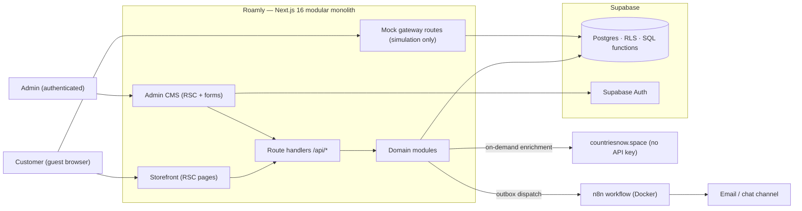
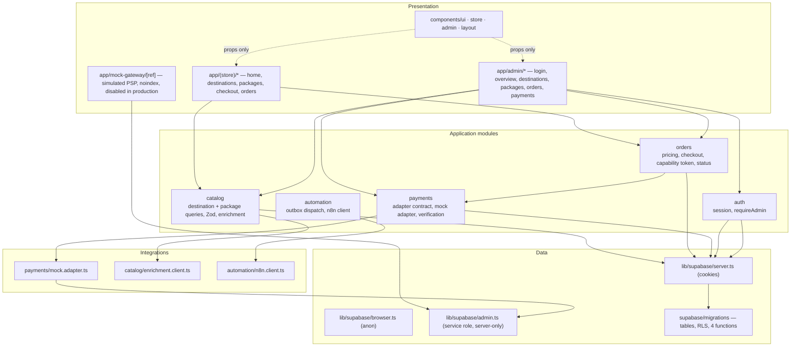
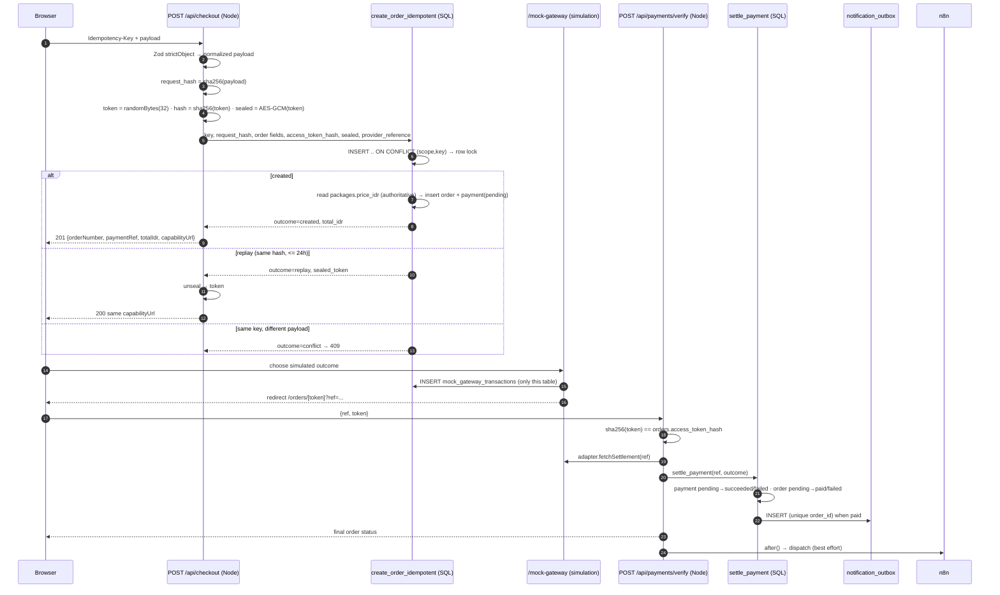
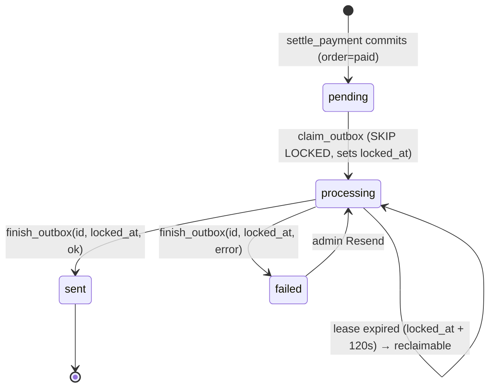

# Architecture

Status: `Approved`. Implementation: none yet.

This document owns the **system shape**: runtime boundaries, module responsibilities,
and how data moves. Technology rationale lives in
[`technical-decisions.md`](technical-decisions.md); tables and constraints in
[`database-design.md`](database-design.md); endpoints in [`api-contract.md`](api-contract.md).

## 1. Style: modular monolith

One Next.js deployment, four responsibility layers, no separate services.

```text
Presentation  →  Application (modules)  →  Data (Supabase + SQL functions)  →  Integrations
```

Rationale: a single technical-test MVP needs one deployment and one database. Splitting
into services would add operational cost without demonstrating anything extra. Modules are
the seam that keeps the option to split open.

## 2. System context



| Actor | Authenticates | Can reach |
| --- | --- | --- |
| Customer (guest) | no | storefront, checkout, capability order page, mock gateway |
| Admin | Supabase Auth session | `/admin/*` and `/api/admin/*` |
| Server (service role) | n/a | all tables after explicit authorization |
| n8n | outbound only | receives webhook; never calls back into Roamly |

## 3. Component diagram



## 4. Module responsibilities

| Module | Owns | Must not |
| --- | --- | --- |
| `catalog` | Public read of active destinations/packages, admin CRUD, Zod schemas, country-data enrichment, `is_active`/`sort_order` rules | Compute order totals, touch payments |
| `orders` | Server-side pricing, checkout validation, order + capability token creation, order status reads, admin order queries | Call an HTTP payment provider directly |
| `payments` | Adapter contract, mock adapter, settlement verification, single-payment guarantee, admin payment queries | Build the checkout payload |
| `automation` | Outbox claim/finish, n8n POST, payload minimisation, retry bounds | Decide payment or order status |
| `auth` | Session read, admin check, `requireAdmin()`, `proxy.ts` guard | Store secrets |
| `lib/supabase/*` | Three clients with distinct privilege levels | Contain business rules |
| `components/ui/*` | Buttons, inputs, select, modal, table, search, range filter, status badge | Query the database or format money ad hoc |

## 5. Request paths

### 5.1 Read path (storefront and admin)

Server Components query through the module's `queries.ts` and the cookie-bound Supabase
client. There is no `fetch()` from a Server Component to a local route handler.

Admin reads additionally pass `requireAdmin()`; RLS is the second layer.

### 5.2 Write path (checkout, payment, admin CRUD)

Route handlers validate with Zod, call one module service, and return JSON. Every write
that touches more than one row goes through a Postgres function.

## 6. Checkout and payment flow



### 6.1 Why the browser is not the source of truth for payment

1. The browser never sends `paymentStatus` or `orderStatus`; it only chooses an outcome on
   the simulated PSP page, exactly like a card outcome at a real gateway.
2. The status applied by the system is re-read server-side from the gateway's own record
   (`mock_gateway_transactions`) through `adapter.fetchSettlement()`.
3. Transition happens only inside `settle_payment`, with `WHERE status = 'pending'` guards,
   so repeats and late requests are no-ops.
4. The settle route has no code path that writes `orders` or `payments`.
5. The adapter contract mirrors a real PSP (`createIntent`, `fetchSettlement`), so replacing
   the mock with a sandbox provider is an adapter swap — not an architecture change.

## 7. Outbox and notification flow



| Property | Value |
| --- | --- |
| Durable state | the `notification_outbox` row, committed with the payment transaction |
| Dispatcher | `after()` in the verify request, or the admin resend route |
| Mutual exclusion | `FOR UPDATE SKIP LOCKED` + `status='processing'` |
| Lost-update protection | `finish_outbox` requires the caller's `locked_at` (fencing token) |
| Lease | 120 s; HTTP timeout 10 s; one retry inside the same claim (≤ 20 s) |
| Delivery semantics | at-least-once; exactly-once is not claimed |
| Receiver dedup key | `notificationId` = `notification_outbox.id`, stable across resends |
| Recovery | lease reclaim, then admin resend; no scheduler, no queue, no worker |

`after()` is a post-response hook, not a durable queue: if the process dies before the row
is claimed, the row stays `pending` and only the admin resend will deliver it. This is
visible in the admin order list.

## 8. External integration

`catalog/enrichment.client.ts` calls `countriesnow.space` **only** when an admin presses
"Fill from API" on the destination form. It returns data to the form; it never writes the
database. Timeout 5 s, one retry, explicit failure surfaced as `503` — the form remains
submittable by hand. Region is authored by the admin, not fetched.

## 9. Cross-cutting concerns

| Concern | Mechanism |
| --- | --- |
| Admin authorization | `proxy.ts` session refresh + `requireAdmin()` in every admin route/page; RLS as second layer |
| Guest order authorization | 32-byte capability token; SHA-256 hash stored; comparison against `access_token_hash` |
| Capability URL hardening | `next.config.ts` headers for `/orders/:path*` and `/mock-gateway/:path*`; route handlers set their own `Cache-Control` |
| Logging | single `lib/logger.ts` with key/path redaction; no analytics or error-monitoring SDK |
| Validation | Zod v4 `strictObject` at every boundary; query params clamped server-side |
| Money | integer IDR, computed in SQL from `packages.price_idr` |
| Time | `timestamptz` UTC in DB, rendered in `Asia/Jakarta` by one formatter |
| Pagination | keyset `(created_at, id)` descending, hard cap 10 |

## 10. Runtime notes and constraints

- Node runtime is required for the proxy (edge is not supported by `proxy.ts`) and for
  `node:crypto` sealing. No route in this app needs edge.
- Route handlers that read the session are dynamic by nature; unknown order tokens return
  `404` with a uniform body to prevent enumeration.
- Local development needs Docker for the Supabase stack and n8n. The documentation phase
  installs nothing.

## 11. Non-goals

Microservices, service discovery, message broker, Redis, Kubernetes, multi-tenancy,
event sourcing, CQRS, background workers, real-time subscriptions, i18n, and any second
payment provider integration.
