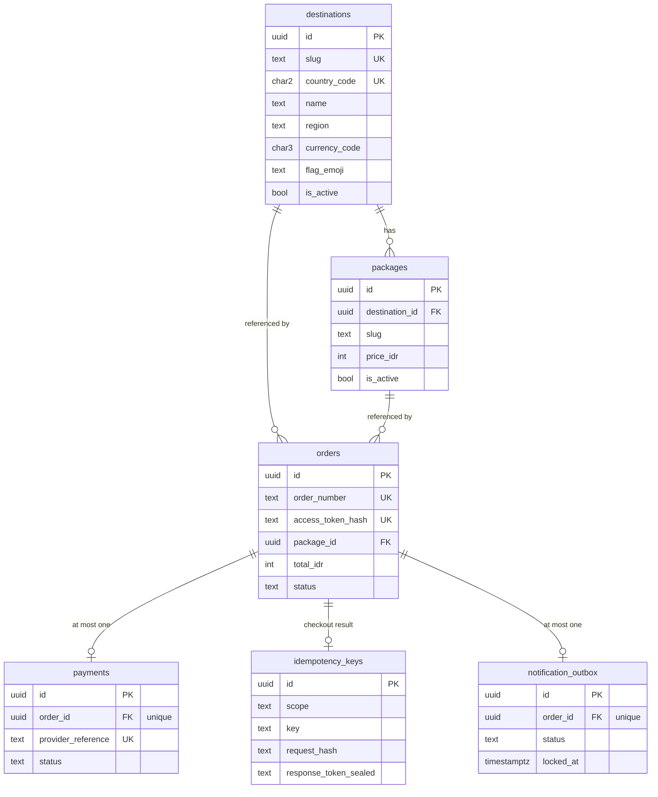

# Database Design

Status: `Approved`. Migrations: **not created yet**.

This document is the authority for tables, constraints, indexes, RLS policies, and SQL
function signatures. Rationale for the approach is in
[`technical-decisions.md`](technical-decisions.md) (ADR-4, ADR-5, ADR-6, ADR-9);
endpoints that call these objects are in [`api-contract.md`](api-contract.md).

Conventions:

- Primary key `uuid` with `gen_random_uuid()`.
- Money is `integer` IDR. No `numeric`, no floats.
- Time is `timestamptz`, stored UTC, rendered `Asia/Jakarta` by `src/lib/format.ts`.
- Status values are `text` + `CHECK` (simpler migrations than native enums, same guarantee).
- `updated_at` maintained by a single `set_updated_at()` trigger on mutable tables.
- `pgcrypto` is **not** required: tokens, hashes, and encryption happen in Node (ADR-6).

## 1. ERD



Relationship summary:

| Relation | Cardinality | Enforcement |
| --- | --- | --- |
| destination → packages | 1..n | FK, `ON DELETE RESTRICT` |
| order → destination, package | n..1 each | FK `RESTRICT` + name/price snapshots on the order |
| **order → payment** | **at most 1** (0..1; row is created together with the order by `create_order_idempotent`) | `payments.order_id UNIQUE` + `NOT NULL`. The constraint only caps at one; existence is guaranteed by the single-writer RPC, not by a constraint |
| order → idempotency key | 0..1 | nullable `idempotency_keys.order_id` |
| order → outbox row | 0..1 | `notification_outbox.order_id UNIQUE` |

A `mock_gateway_transactions` table also exists; it is owned by the *simulated provider* and
has no FK into business tables — that separation is what makes it structurally impossible
for the simulation page to change an order.

## 2. Tables

### 2.1 `destinations`

| Column | Type | Constraints |
| --- | --- | --- |
| `id` | uuid | PK, default `gen_random_uuid()` |
| `slug` | text | not null, unique, `CHECK (slug ~ '^[a-z0-9-]+$')` |
| `country_code` | char(2) | not null, unique, uppercase |
| `name` | text | not null |
| `region` | text | not null — admin-authored (`Asia`, `Europe`, …), not from the API |
| `currency_code` | char(3) | not null |
| `flag_emoji` | text | null — from `unicodeFlag`, no external CDN |
| `summary` | text | not null, `CHECK (char_length(summary) <= 160)` |
| `description` | text | null |
| `hero_image_url` | text | not null |
| `hero_image_attribution` | text | not null — required for CC BY / CC BY-SA |
| `is_active` | boolean | not null, default `true` |
| `sort_order` | smallint | not null, default `0` |
| `created_at` | timestamptz | not null, default `now()` |
| `updated_at` | timestamptz | not null, default `now()`, trigger |

No `timezone` column: unused by any screen (decision D1 / ADR-8).

### 2.2 `packages`

| Column | Type | Constraints |
| --- | --- | --- |
| `id` | uuid | PK |
| `destination_id` | uuid | not null, FK → `destinations(id)` `ON DELETE RESTRICT` |
| `slug` | text | not null |
| `name` | text | not null |
| `data_mb` | integer | null |
| `is_unlimited` | boolean | not null, default `false` |
| `validity_days` | smallint | not null, `CHECK (validity_days BETWEEN 1 AND 90)` |
| `price_idr` | integer | not null, `CHECK (price_idr >= 0)` — **authoritative price** |
| `compare_at_price_idr` | integer | null, `CHECK (compare_at_price_idr IS NULL OR compare_at_price_idr > price_idr)` |
| `network` | text | null |
| `hotspot_allowed` | boolean | not null, default `true` |
| `is_active` | boolean | not null, default `true` |
| `created_at` / `updated_at` | timestamptz | not null, trigger on update |

Table constraints:

```sql
UNIQUE (destination_id, slug)

-- A NULL data_mb must never pass for a metered package. `NULL > 0` evaluates to NULL,
-- and a CHECK fails only on FALSE, so the previous form
-- `CHECK (is_unlimited OR data_mb > 0)` accepted (is_unlimited=false, data_mb=NULL).
CHECK (
  (is_unlimited AND data_mb IS NULL)
  OR (NOT is_unlimited AND data_mb IS NOT NULL AND data_mb > 0)
)

-- Ceiling keeps unit_price_idr * quantity (max 5) inside int4 (2,147,483,647).
CHECK (price_idr BETWEEN 1 AND 100000000)
CHECK (compare_at_price_idr IS NULL OR compare_at_price_idr > price_idr)
CHECK (validity_days BETWEEN 1 AND 90)
```

`price_idr >= 1` (not `>= 0`) so a free package cannot create a payment whose
`amount_idr` is 0, which `payments.amount_idr > 0` would reject.

### 2.3 `orders`

| Column | Type | Constraints |
| --- | --- | --- |
| `id` | uuid | PK |
| `order_number` | text | not null, unique, format `RML-[A-Z0-9]{6}` — display only |
| `access_token_hash` | text | not null, unique, `CHECK (char_length = 64)` — SHA-256 hex |
| `destination_id` | uuid | not null, FK → `destinations(id)` `RESTRICT` |
| `package_id` | uuid | not null, FK → `packages(id)` `RESTRICT` |
| `destination_name_snapshot` | text | not null |
| `package_name_snapshot` | text | not null |
| `package_data_snapshot` | text | not null — per-unit content, e.g. `5 GB · 15 hari`, `Unlimited · 7 hari` |
| `customer_name` | text | not null |
| `customer_email` | text | not null, stored lowercased |
| `customer_phone` | text | not null, normalized E.164-ish (`+62…`) |
| `quantity` | smallint | not null, default 1, `CHECK (quantity BETWEEN 1 AND 5)` |
| `unit_price_idr` | integer | not null, `CHECK (unit_price_idr >= 0)` |
| `total_idr` | integer | not null, `CHECK (total_idr = unit_price_idr * quantity)` |
| `status` | text | not null, default `'pending'`, `CHECK (status IN ('pending','paid','failed'))` |
| `paid_at` | timestamptz | null |
| `created_at` / `updated_at` | timestamptz | not null, trigger |

There is **no** token column and **no** `expired` status. Snapshots freeze the commercial
terms so a later package edit does not rewrite history.

`package_data_snapshot` is derived by `create_order_idempotent` from the package columns
that actually exist (`data_mb`, `is_unlimited`, `validity_days`) — `packages` has no such
column itself:

```sql
case
  when p.is_unlimited then 'Unlimited · ' || p.validity_days::text || ' hari'
  when p.data_mb % 1024 = 0
    then (p.data_mb / 1024)::text || ' GB · ' || p.validity_days::text || ' hari'
  else p.data_mb::text || ' MB · ' || p.validity_days::text || ' hari'
end
```

The rule is deterministic and rounds nothing (`5120` → `5 GB`, `3000` → `3000 MB`). The
package CHECK guarantees `data_mb IS NULL` only when `is_unlimited` is true, so the other
branches never receive NULL. The string is per unit; the UI renders totals as
`{snapshot} × {quantity}`.

### 2.4 `payments`

| Column | Type | Constraints |
| --- | --- | --- |
| `id` | uuid | PK |
| `order_id` | uuid | **not null, UNIQUE**, FK → `orders(id)` `RESTRICT` |
| `provider` | text | not null, default `'mock'` |
| `provider_reference` | text | not null, unique, format `mock_` + 24 hex |
| `amount_idr` | integer | not null, `CHECK (amount_idr > 0)` |
| `status` | text | not null, default `'pending'`, `CHECK (status IN ('pending','succeeded','failed'))` |
| `failure_code` | text | null |
| `paid_at` | timestamptz | null |
| `created_at` / `updated_at` | timestamptz | not null, trigger |

`UNIQUE (order_id)` is the database-level guarantee that an order cannot be paid twice.
No partial unique index is needed; `failed` is terminal, so no second attempt is modelled.

### 2.5 `idempotency_keys`

| Column | Type | Constraints |
| --- | --- | --- |
| `id` | uuid | PK |
| `scope` | text | not null, default `'checkout'` |
| `key` | text | not null, `CHECK (key ~ '^[A-Za-z0-9_-]{22,64}$')` |
| `request_hash` | text | not null, `CHECK (char_length = 64)` |
| `order_id` | uuid | null, FK → `orders(id)` `RESTRICT` |
| `response_status` | smallint | null |
| `response_body` | jsonb | null — `{order_number, payment_ref, total_idr}`, **never a token** |
| `response_token_sealed` | text | null — `v1.<iv>.<tag>.<ct>` (AES-256-GCM, base64url parts) |
| `created_at` | timestamptz | not null, default `now()` |
| `touched_at` | timestamptz | not null, default `now()` |

Table constraints:

```sql
UNIQUE (scope, key)                     -- the idempotency guarantee
CHECK (order_id IS NOT NULL OR response_status IS NULL)  -- no response without an order
```

Rows are never deleted. Replay is refused after 24 h (`IDEMPOTENCY_EXPIRED`), which is
enforced in the function, not by a cleanup job.

### 2.6 `notification_outbox`

| Column | Type | Constraints |
| --- | --- | --- |
| `id` | uuid | PK — this value is the `notificationId` in the webhook payload |
| `order_id` | uuid | not null, **UNIQUE**, FK → `orders(id)` `RESTRICT` |
| `payload` | jsonb | not null — minimized, no token, no capability URL |
| `status` | text | not null, default `'pending'`, `CHECK (status IN ('pending','processing','sent','failed'))` |
| `attempts` | smallint | not null, default 0, `CHECK (attempts <= 5)` |
| `locked_at` | timestamptz | null — claim lease timestamp and **fencing token** |
| `sent_at` | timestamptz | null |
| `last_error` | text | null |
| `created_at` | timestamptz | not null, default `now()` |

No `event_type` (one event per order), no `next_attempt_at` (no scheduler).

Payload CHECK — the payload must carry every key of the notification contract (extra keys
are allowed, and adding one later needs no migration):

```sql
CHECK (
  payload ? 'notificationId' AND payload ? 'orderNumber' AND payload ? 'totalIdr'
  AND payload ? 'customerName'  AND payload ? 'customerEmail' AND payload ? 'paidAt'
  AND payload ? 'destinationName' AND payload ? 'packageName'
  AND payload ? 'packageDataSnapshot'
)
```

`payload.notificationId` must equal `id`; that cross-column equality is set inside
`settle_payment` (insert uses `RETURNING id`) and asserted by an integration test, because a
CHECK cannot compare two columns of the same row reliably against a JSON value.

### 2.7 `mock_gateway_transactions`

| Column | Type | Constraints |
| --- | --- | --- |
| `id` | uuid | PK |
| `provider_reference` | text | not null, unique |
| `outcome` | text | not null, `CHECK (outcome IN ('succeeded','failed','pending'))` |
| `note` | text | null |
| `created_at` | timestamptz | not null, default `now()` |

Owned by the simulated provider. No FK to `orders`/`payments`: the simulation route cannot
cascade into business state. Writes go through `record_mock_settlement` only (§5.5); no client
role has `INSERT` here.

### 2.8 Triggers and invariants (no new table)

Every invariant below is enforced **in the database**, so it holds even for `service_role`
(which bypasses RLS but not triggers or constraints).

| Invariant | Statement | Enforced by |
| --- | --- | --- |
| **I1** | `payments.amount_idr = orders.total_idr` | `enforce_payment_amount` (BEFORE INSERT/UPDATE on `payments`) |
| **I2** | `orders.status = 'paid'` ⟺ `payments.status = 'succeeded'` | constraint triggers `payments_i2` and `orders_i2` (`AFTER … DEFERRABLE INITIALLY DEFERRED`) |
| **I3** | `status = 'paid'` ⟺ `paid_at IS NOT NULL` (both tables) | `CHECK ((status = 'paid') = (paid_at IS NOT NULL))` / `((status = 'succeeded') = …)` |
| **I4** | `failure_code` present only when `status = 'failed'` | two `CHECK`s on `payments` |
| **I5** | outbox exists ⟺ order is `paid`, exactly one row | `guard_outbox_order_is_paid` (BEFORE, immediate) + constraint triggers `outbox_i5` and `orders_i5` (deferred) |
| **I6** | terminal rows are immutable | `orders_before_update` / `payments_before_update` (raise `22000` when `OLD.status` is terminal) |
| **I7** | at most one payment per order | `UNIQUE (order_id)` |
| **I8** | price computed server-side | `create_order_idempotent` is the only `INSERT` into `orders`; plus I1/I3 |
| **I9** | settlement is atomic across payment + order + outbox | `settle_payment` is the only status writer; plus I2/I5/I6 |

Notes that keep the triggers consistent:

- `orders_before_update` and `payments_before_update` are **single** `BEFORE UPDATE` triggers that
  both reject terminal rows and set `updated_at`. One trigger avoids non-deterministic ordering
  between a separate `set_updated_at` and the terminal guard.
- Deferred triggers are validated at **COMMIT** under READ COMMITTED, so `settle_payment` may
  write payment → order → outbox in any order within one transaction; only the final state is
  judged.
- `assert_order_payment_consistency` and `assert_outbox_matches_paid` read the affected order
  ids from `OLD` **and** `NEW`, so a `payments.order_id` change `A → B` validates both sides. A
  missing referenced order raises instead of being skipped.
- Placement (functions must exist before the tables that attach the triggers): migration 1
  creates the functions; the `BEFORE`/constraint triggers are created together with their
  tables in migrations 2–4.

## 3. Indexes

| Index | Definition | Query it serves |
| --- | --- | --- |
| `destinations_active_sort` | `(is_active, sort_order, name)` | storefront listing |
| `packages_dest_active_price` | `(destination_id, is_active, price_idr)` | packages per destination, price sort |
| `orders_created_keyset` | `(created_at DESC, id DESC)` | admin default "newest first" |
| `orders_status_created` | `(status, created_at DESC, id DESC)` | admin status filter + range |
| `orders_email_lower` | `(lower(customer_email))` | admin search by email |
| `payments_created_keyset` | `(created_at DESC, id DESC)` | admin payments list |
| `outbox_dispatchable` | `(created_at) WHERE status IN ('pending','failed','processing')` | claim scan |
| `idempotency_touched` | `(touched_at DESC)` | housekeeping review |

Uniqueness already indexes: `destinations.slug`, `destinations.country_code`,
`packages(destination_id, slug)`, `orders.order_number`, `orders.access_token_hash`,
`payments.order_id`, `payments.provider_reference`,
`idempotency_keys(scope, key)`, `notification_outbox.order_id`.

Query rules: `select` explicit columns only, no `*`; admin lists cap `limit` at 10 with
keyset `(created_at, id)`; no per-row follow-up queries (join `packages`/aggregate
`payments.status` in the same statement).

## 4. Row Level Security

RLS is enabled on **every** table. Default posture is deny.

```sql
-- Admin identity, evaluated from the JWT claim set by Supabase Auth.
create or replace function public.is_admin() returns boolean
language sql stable as $$
  select coalesce((auth.jwt() -> 'app_metadata' ->> 'role') = 'admin', false);
$$;

-- Only the role that actually evaluates the admin policies may execute it.
-- Policies are evaluated as the querying role, and every policy that calls
-- is_admin() targets `authenticated`. anon never calls it; service_role bypasses RLS
-- and never calls it either. SECURITY DEFINER functions run as their owner
-- (postgres), which always has implicit rights on its own function.
revoke all on function public.is_admin() from public, anon, service_role;
grant execute on function public.is_admin() to authenticated;
```

**7 policies** (deny by default everywhere else):

| Table | Policy | Role | Rule |
| --- | --- | --- | --- |
| `destinations` | `dest_public_read` | `anon`, `authenticated` | `is_active = true` |
| `destinations` | `dest_admin_all` | `authenticated` | `is_admin()` |
| `packages` | `pkg_public_read` | `anon`, `authenticated` | `is_active = true` |
| `packages` | `pkg_admin_all` | `authenticated` | `is_admin()` |
| `orders` | `orders_admin_read` | `authenticated` | `is_admin()` |
| `payments` | `payments_admin_read` | `authenticated` | `is_admin()` |
| `notification_outbox` | `outbox_admin_read` | `authenticated` | `is_admin()` |

`orders`, `payments`, `idempotency_keys`, `notification_outbox` and
`mock_gateway_transactions` have **no** anon policy and **no** INSERT/UPDATE/DELETE policy
for any client role.

### Table privileges (the layer below RLS)

| Table | `anon` | `authenticated` | `service_role` | Write path |
| --- | --- | --- | --- | --- |
| `destinations` | SELECT | SELECT, INSERT, UPDATE, DELETE | — | `authenticated` + RLS `is_admin()` |
| `packages` | SELECT | SELECT, INSERT, UPDATE, DELETE | — | idem |
| `orders` | — | SELECT (RLS `is_admin()`) | SELECT | `create_order_idempotent`, `settle_payment` |
| `payments` | — | SELECT (RLS `is_admin()`) | SELECT | idem |
| `idempotency_keys` | — | — | — | `create_order_idempotent` (read/write internally) |
| `notification_outbox` | — | SELECT (RLS `is_admin()`) | SELECT | `settle_payment` (INSERT), `claim_outbox`, `finish_outbox` |
| `mock_gateway_transactions` | — | — | SELECT | `record_mock_settlement` |

```sql
-- service_role deliberately has no write privilege on the transactional tables:
-- the five SECURITY DEFINER functions are the only writers (single-writer).
revoke insert, update, delete on
  public.orders, public.payments, public.idempotency_keys,
  public.notification_outbox, public.mock_gateway_transactions
  from anon, authenticated, service_role;

-- The app never needs to write catalog rows through service_role either.
revoke all on public.destinations, public.packages from service_role;

grant select on public.destinations, public.packages to anon, authenticated;
grant insert, update, delete on public.destinations, public.packages to authenticated;
grant select on public.orders, public.payments, public.notification_outbox,
  public.mock_gateway_transactions to service_role;
grant select on public.orders, public.payments, public.notification_outbox to authenticated;
```

**Function privileges**

| Function | `anon` | `authenticated` | `service_role` |
| --- | --- | --- | --- |
| `public.is_admin()` | — | EXECUTE | — |
| `create_order_idempotent`, `settle_payment`, `claim_outbox`, `finish_outbox`, `record_mock_settlement` | — | — | EXECUTE |
| `assert_order_payment_consistency`, `assert_outbox_matches_paid`, `guard_outbox_order_is_paid`, `orders_before_update`, `payments_before_update`, `set_updated_at`, `enforce_payment_amount` | — | — | — (trigger-only; trigger invocation does not check EXECUTE) |

**Hardening for `SECURITY DEFINER` (all five RPCs and all trigger functions)**

- `set search_path = ''` and fully schema-qualified object names;
- `alter function … owner to postgres`;
- `revoke all on function … from public` (PostgreSQL grants EXECUTE to PUBLIC by default);
- `revoke create on schema public from public, anon, authenticated, service_role`.

**RLS does not protect service role.** `service_role` has `BYPASSRLS`, so policies are not
evaluated for it; its safety comes from the missing write grants plus the triggers and
constraints, not from RLS. Conversely `postgres` (function owner) bypasses RLS as table
owner, which is why the definer validators can read business rows regardless of the caller.

Consequences:

- Guest order reads never go through `anon`. The route handler validates the capability
  token with the service client and returns an explicit column whitelist (plus a Zod DTO,
  see `AGENTS.md`).
- The service role is used **only** after an authorization decision in server code
  (`requireAdmin()` or capability-token match), never as a shortcut for client requests.
- Admin catalog and admin list reads travel through the **authenticated** client so that
  RLS (not the service key) is the enforcing layer; `requireAdmin()` is still called first.
- Integration tests must assert `select` on `orders` as `anon` fails (`42501`) and as a
  non-admin `authenticated` user returns zero rows.
- `anon` has no INSERT path into `mock_gateway_transactions`; the simulation route writes
  through `record_mock_settlement` as the server.

## 5. SQL functions

Five functions are `security definer`, owned by `postgres`, with `search_path = ''`
(schema-qualified inside), and executable only by the service role
(`revoke all ... from public, anon, authenticated` then `grant execute ... to service_role`).
Node calls them via `supabase.rpc()`. Trigger functions are also `security definer` but get
no EXECUTE grant — triggers do not check the caller's EXECUTE privilege.

### 5.1 `create_order_idempotent`

```sql
create_order_idempotent(
  p_key          text,    -- '^[A-Za-z0-9_-]{22,64}$'
  p_request_hash text,    -- sha256 hex of the normalized payload
  p_order        jsonb    -- {package_id, quantity, customer_name, customer_email,
                          --  customer_phone, order_number, access_token_hash,
                          --  response_token_sealed, provider_reference}
) returns jsonb
-- → {outcome: 'created'|'replay'|'conflict'|'expired'|'package_inactive',
--    order_number, payment_ref, total_idr, unit_price_idr, sealed_token?}
```

Steps, in one transaction:

1. `INSERT INTO idempotency_keys (scope, key, request_hash) VALUES ('checkout', p_key, p_request_hash)
   ON CONFLICT (scope, key) DO UPDATE SET touched_at = now() RETURNING *` — this also takes
   the row lock that serialises concurrent requests.
2. If the returned row already has `order_id`: compare `request_hash`.
   `created_at > now() - interval '24 hours'` → `replay` (return stored
   `response_body` + `response_token_sealed` as `sealed_token`). Older → `expired`.
   Different hash → `conflict`. No writes in any of these branches.
3. Otherwise read the package:
   `SELECT price_idr FROM packages WHERE id = (p_order->>'package_id')::uuid AND is_active`.
   Missing/inactive → `package_inactive`, nothing written.
4. `unit_price = price_idr`, `total = unit_price * quantity`.
5. Insert `orders` (status `pending`, snapshots from destination/package, provided
   `order_number`, `access_token_hash`) and `payments` (status `pending`,
   `provider_reference`, `amount_idr = total`).
6. Update the idempotency row: `order_id`, `response_status = 201`,
   `response_body = {order_number, payment_ref, total_idr}`,
   `response_token_sealed`, `touched_at = now()`.
7. Return `created` with totals.

Guarantees: prices come from the database, not from the request; one key yields one order;
concurrent duplicates either replay or block, never duplicate.

### 5.2 `settle_payment`

```sql
settle_payment(p_provider_reference text, p_outcome text) returns jsonb
-- → {outcome: 'applied'|'unchanged'|'not_found', order_status, payment_status}
```

Validation (explicit, no NULL passthrough):

- `p_provider_reference IS NULL` or length outside 8..64 → `RAISE '22000'` (`INVALID_REF`)
- `p_outcome IS NULL` or not in (`'succeeded'`, `'failed'`) → `RAISE '22000'` (`INVALID_OUTCOME`)

`'pending'` is **not** accepted here: settling means applying a terminal gateway decision.
A pending gateway result is handled by the E-5 verify route, which returns
`{ paymentStatus: 'pending' }` **without** calling this function. The adapter contract types
the result as a discriminated union (`'succeeded' | 'failed' | 'pending'`) so the compiler
forces that branch.

1. `SELECT ... FROM payments WHERE provider_reference = $1 FOR UPDATE`.
2. Row missing → `not_found`.
3. `status <> 'pending'` → `unchanged` (idempotent, no writes).
4. `p_outcome = 'succeeded'` → payment `succeeded` + `paid_at`; order `pending → paid` +
   `paid_at`; then insert the outbox row
   (`ON CONFLICT (order_id) DO NOTHING`) with the minimized payload.
5. `p_outcome = 'failed'` → payment `failed` (+`failure_code`); order `pending → failed`.
   No outbox row.

Every `UPDATE` carries `AND status = 'pending'`. `failed` and `paid` are terminal.

All five RPCs assume **READ COMMITTED** (the PostgREST/Supabase default). No
`SET TRANSACTION`, no advisory locks, no retry framework. `claim_outbox(p_order_id)`
accepts `NULL` as a documented sentinel meaning "any eligible row", not a missing value.

### 5.3 `claim_outbox`

```sql
claim_outbox(p_order_id uuid default null) returns jsonb
-- → {outcome:'claimed', id, order_id, attempts, locked_at} | {outcome:'none'}
```

```sql
UPDATE notification_outbox
   SET status = 'processing', locked_at = now(), attempts = attempts + 1
 WHERE id = (
   SELECT o.id
     FROM notification_outbox o
     JOIN orders od ON od.id = o.order_id AND od.status = 'paid'
    WHERE (o.status IN ('pending','failed')
           OR (o.status = 'processing' AND o.locked_at < now() - interval '120 seconds'))
      AND o.attempts < 5
      AND (p_order_id IS NULL OR o.order_id = p_order_id)
    ORDER BY o.created_at
    FOR UPDATE SKIP LOCKED
    LIMIT 1)
RETURNING id, order_id, attempts, locked_at;
```

`locked_at` is returned because it is the caller's fencing token. `0 rows` → `none`; the
caller must not send anything.

### 5.4 `finish_outbox`

```sql
finish_outbox(p_id uuid, p_locked_at timestamptz, p_ok boolean, p_error text default null)
returns jsonb
-- → {outcome:'sent'|'failed'|'stale'}
```

```sql
UPDATE notification_outbox
   SET status    = CASE WHEN p_ok THEN 'sent' ELSE 'failed' END,
       sent_at   = CASE WHEN p_ok THEN now() ELSE NULL END,
       last_error= p_error,
       locked_at = NULL
 WHERE id = p_id
   AND status = 'processing'
   AND locked_at = p_locked_at;      -- fencing: only the claim holder may finish
```

`0 rows` → `stale`: a newer claim owns the row; the caller changes nothing and logs a
warning. This is what prevents a slow dispatcher from overwriting a newer attempt.

`p_id`, `p_locked_at` or `p_ok` being NULL → `RAISE '22000'` (explicit validation).

### 5.5 `record_mock_settlement`

```sql
record_mock_settlement(p_ref text, p_outcome text) returns jsonb
-- → {outcome, recorded:boolean, transition:'created'|'pending_to_terminal'|'replay'|'conflict'}
```

Owns the simulated provider's own table (`mock_gateway_transactions`) and **never** touches
`orders` or `payments` — it cannot replace `settle_payment`.

Validation: `p_ref IS NULL` or length outside 8..64 → `RAISE '22000'`;
`p_outcome IS NULL` or not in (`'pending'`, `'succeeded'`, `'failed'`) → `RAISE '22000'`.

State machine (a `pending` record **may** advance to a terminal outcome; a terminal record
is immutable):

| Stored | Incoming | Behaviour | Response |
| --- | --- | --- | --- |
| none | any valid | `INSERT` | `created` |
| `pending` | `pending` | replay, no write | `replay` |
| `pending` | `succeeded` / `failed` | transition allowed | `pending_to_terminal` |
| terminal | same | replay, no write | `replay` |
| terminal | different terminal | **no overwrite** | `conflict` (returns the stored value) |

```sql
-- (1) pending -> terminal (locks the existing row)
UPDATE public.mock_gateway_transactions SET outcome = p_outcome
 WHERE provider_reference = p_ref AND outcome = 'pending'
   AND p_outcome IN ('succeeded','failed');
IF FOUND THEN RETURN jsonb_build_object('outcome',p_outcome,'recorded',true,'transition','pending_to_terminal'); END IF;

-- (2) brand-new reference
INSERT INTO public.mock_gateway_transactions (provider_reference, outcome)
VALUES (p_ref, p_outcome) ON CONFLICT (provider_reference) DO NOTHING;
IF FOUND THEN RETURN jsonb_build_object('outcome',p_outcome,'recorded',true,'transition','created'); END IF;

-- (3) existing terminal row: replay or conflict. FOUND is checked, never a NULL value.
SELECT outcome INTO v_stored FROM public.mock_gateway_transactions WHERE provider_reference = p_ref;
v_found := FOUND;
IF NOT v_found THEN RAISE EXCEPTION 'MOCK_RECORD_MISSING' USING ERRCODE = '22000'; END IF;
IF v_stored = p_outcome
  THEN RETURN jsonb_build_object('outcome',v_stored,'recorded',false,'transition','replay');
  ELSE RETURN jsonb_build_object('outcome',v_stored,'recorded',false,'transition','conflict');
END IF;
```

Concurrency: `UNIQUE (provider_reference)` serialises competing calls; step (1) takes a row
lock, so two simultaneous `pending → terminal` transitions cannot both apply (first wins,
second returns `conflict`). `created_at` is never modified on transition.

## 6. Transaction boundaries

| Operation | Unit of atomicity |
| --- | --- |
| Checkout | `create_order_idempotent` (order + payment + idempotency metadata) |
| Payment settlement | `settle_payment` (payment + order + outbox row) |
| Notification claim | `claim_outbox` (single `UPDATE`) |
| Notification completion | `finish_outbox` (single fenced `UPDATE`) |
| Mock settlement record | `record_mock_settlement` (single `INSERT`/`UPDATE` on the provider table only) |
| Admin CRUD | one statement per request; no cross-table invariant |

Nothing else may write `orders.status`, `payments.status`, or `notification_outbox.status`.
`service_role` holds no INSERT/UPDATE/DELETE on the transactional tables, so the five RPC
functions above are the only writer paths.

## 7. Seed data

Five destinations, three packages each (15 rows), all `is_active`:

| Country | `country_code` | Region | Currency | Flagship package shape |
| --- | --- | --- | --- | --- |
| Japan | JP | Asia | JPY | 5 GB / 15 days |
| Singapore | SG | Asia | SGD | 3 GB / 7 days |
| Thailand | TH | Asia | THB | 10 GB / 30 days |
| Malaysia | MY | Asia | MYR | 5 GB / 15 days |
| Switzerland | CH | Europe | CHF | 5 GB / 15 days |

Seed is idempotent (`ON CONFLICT (slug) DO NOTHING`) so `db reset` is repeatable.
