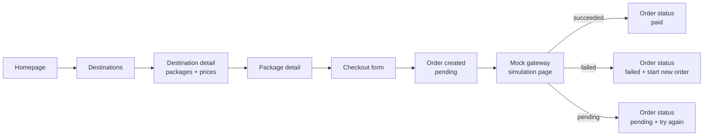
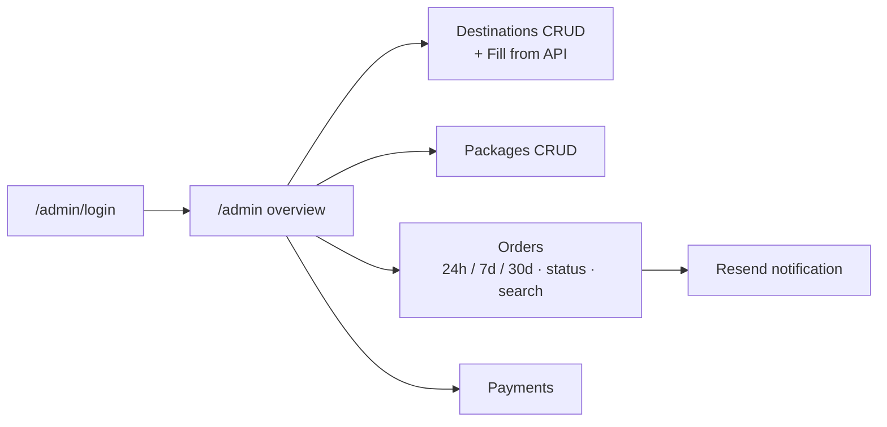

# Design Solution

Status: `Approved` (direction). Imagery: **`APPROVED FOR MVP`** — the five candidates were
verified technically and are approved for MVP use; final asset selection is deferred to post-MVP.

Owns product concept, flows, sitemap, visual tokens, page layouts, and asset strategy.
Scope boundaries live in [`mvp-scope.md`](mvp-scope.md); technical rationale in
[`technical-decisions.md`](technical-decisions.md).

## 1. Product concept

A traveller lands on a page that feels like a travel magazine, picks a country, picks a data
package, pays, and immediately sees the order status. No account, no dashboard, no noise.

Three design promises:

1. **The destination is the hero.** Photography carries the emotion; the interface stays quiet.
2. **Every element earns its place.** If it does not help choose or confirm, it is removed.
3. **Trust through clarity.** Price, validity, data volume, and status are always explicit.

## 2. Design principles

| Principle | Practical rule |
| --- | --- |
| Editorial, not dashboard | Serif display headings, generous whitespace, one photo per surface |
| Warm and premium | Warm off-white paper, dark navy ink, one forest/teal accent |
| Restrained surface | One elevation level, radii 4/8/12px, 1px sand borders instead of shadows |
| Functional density where it matters | Admin tables are compact and scannable; marketing pages are airy |
| Honest states | Status colour + explicit label; never colour alone |

Avoided by decision: gradients, glassmorphism, decorative blobs, oversized rounded cards,
stacked shadows, chart decoration, animation for its own sake.

## 3. Sitemap

```text
/                              Homepage
/destinations                  All destinations (+ region chips)
/destinations/[slug]           Packages for one destination
/destinations/[slug]/packages/[packageSlug]  Package detail → checkout CTA
/checkout                      Guest form + order summary (single page)
/orders/[token]                Order + payment status (capability link)
/mock-gateway/[ref]            Payment simulation (noindex, disabled in production)
/admin/login                   Admin sign-in
/admin                         Overview
/admin/destinations            List / create / edit / delete
/admin/packages                List / create / edit / delete
/admin/orders                  List + filters + resend notification
/admin/payments                List + filters
```

## 4. User flows

### 4.1 Customer — happy path



### 4.2 Customer — failure and recovery

- **Package deactivated mid-session:** checkout returns a clear message, no order created,
  CTA back to the destination.
- **Payment failed:** terminal state. The page explains that the order cannot be paid and
  offers "Start a new order".
- **Payment pending:** the order stays pending; there is no automatic expiry in the MVP, so
  copy avoids promising a countdown.
- **Lost link:** the page tells the customer to contact the admin with their order number.

### 4.3 Admin



## 5. Visual tokens

### 5.1 Colour

| Token | Hex | Use |
| --- | --- | --- |
| `paper` | `#FAF7F2` | Page background (warm off-white) |
| `surface` | `#FFFFFF` | Cards, form panels, table rows |
| `ink` | `#0E1B2A` | Primary text, headings |
| `ink-muted` | `#5A6B7A` | Secondary text, metadata |
| `forest` | `#1F4B3F` | Primary action, footer, emphasis block |
| `teal` | `#2F7A6B` | Links, focus ring, active filter |
| `sand` | `#E4DCCF` | Borders, dividers, image placeholder |
| `sand-strong` | `#C9BFAE` | Hover border, disabled fill |
| `success` | `#2E7D4F` | `paid` / `succeeded` / `sent` |
| `warn` | `#B4761F` | `pending` / `processing` |
| `danger` | `#B3261E` | `failed` / destructive action |

Contrast: `ink` on `paper` ≈ 14:1; `ink-muted` on `paper` ≈ 4.8:1; white on `forest` ≈ 9:1.
Status badges always pair colour with a text label.

### 5.2 Typography

| Role | Family | Size / weight |
| --- | --- | --- |
| Display (h1) | **Fraunces** (variable serif) | 44–56px mobile 32–36px, weight 500–600, line-height 1.05–1.15 |
| Section heading (h2) | Fraunces | 28–32px, weight 500 |
| Card title (h3) | Inter | 18–20px, weight 600 |
| Body | **Inter** | 16px, weight 400, line-height 1.6 |
| Meta / label | Inter | 13–14px, weight 500, letter-spacing 0.01em |
| Price | Inter | 20–24px, weight 600, `font-variant-numeric: tabular-nums` |

Two families only, self-hosted via `next/font` (no external font requests — required by the
order-page privacy rule).

### 5.3 Spacing, radius, elevation

| Token | Value |
| --- | --- |
| Base unit | 4px |
| Scale | 4, 8, 12, 16, 24, 32, 48, 64, 96 |
| Container | `max-width: 1200px`; gutter 20px mobile, 32px ≥ `md` |
| Section rhythm | 64px mobile, 96px desktop |
| Radius | `4px` inputs/buttons, `8px` cards, `12px` large media |
| Elevation | one level: `0 1px 2px rgba(14,27,42,.06)` — modal and sticky order bar only |
| Border | `1px solid sand` |

### 5.4 Breakpoints

`sm 640` · `md 768` · `lg 1024` · `xl 1280`. Desktop and mobile are both first-class; nothing
is designed "mobile only" or hidden to make a breakpoint fit.

## 6. Page layouts

| Page | Layout | Responsive behaviour |
| --- | --- | --- |
| **Homepage** | 12-col grid. Hero: 6 cols serif headline + supporting line + primary CTA, 6 cols 16:9 photo. Then 5 destination cards in a 2/3-col grid, then "how it works" (3 numbered steps), then a forest-coloured trust strip, then footer | `< md`: hero stacks, photo below headline at 4:3; cards 1 per row |
| **Destination list** | Region chips above a 3-col card grid. Card = photo 4:3, name, `n packages`, "from IDR …" | 2-col at `md`, 1-col `< sm`; chips scroll horizontally |
| **Destination detail** | Header with destination name, flag emoji, region, one-line summary. Package cards in 2 cols: data volume + validity as the headline, price right-aligned, 3 bullet features | 1-col `< md` |
| **Package detail** (`/destinations/[slug]/packages/[packageSlug]`) | 2 cols: content (what you get, validity, network, notes) 7 cols; sticky order card 5 cols with price, total, and "Continue to checkout" | `< lg`: order card becomes a bottom sticky bar with price + CTA |
| **Checkout** | 2 cols: form 7 cols (name, email, phone, optional quantity), summary 5 cols (destination, package, unit price, total, terms note) | `< lg`: summary collapses above the form as a compact accordion |
| **Order status** | Centered single column, max 640px. Status panel (colour + label + one-sentence meaning), order facts, payment facts, then one contextual action | Single column always; no horizontal scroll at 320px |
| **Admin** | Sidebar 240px, header with page title + primary action, content area. Tables: 10 rows, sticky header, `Next`/`Previous` keyset controls | `< lg`: sidebar becomes a drawer; tables become stacked key-value rows |
| **Mock gateway** | Deliberately distinct: sand background, bordered panel, permanent "SIMULATION — NO REAL PAYMENT" banner, three outcome buttons, reference display | Single column |

### 6.1 Order status states

| State | Heading | Body | Primary action |
| --- | --- | --- | --- |
| `pending` + payment `pending` | "Waiting for payment" | "This order has not been paid yet." | "Continue payment" |
| `pending` + gateway `pending` | "Payment in progress" | "The simulated gateway has not decided yet." | "Check status" |
| `paid` | "Payment confirmed" | Package, destination, total, paid time (WIB) | "Back to destinations" |
| `failed` | "Payment failed" | "This order is closed and cannot be paid." | "Start a new order" |
| unknown token | 404 page | "We could not find this order." | "Go to homepage" |

The notification badge (`pending` / `processing` / `sent` / `failed`) appears as small meta
text, never as a promise that an email has arrived.

## 7. Component strategy

| Component | Responsibility | Explicitly not |
| --- | --- | --- |
| `Button` | Variant (`primary`, `secondary`, `ghost`, `danger`), size, loading, disabled | Business logic, navigation side effects |
| `Input`, `Select` | Label, hint, error, required marker | Validation rules (Zod owns them) |
| `Modal` | Focus trap, ESC, backdrop | Data fetching |
| `DataTable` | Column config, row rendering, empty state, sticky header | Supabase calls, filtering, pagination logic |
| `SearchField` | Debounced input (300 ms) bound to a URL parameter | Server-side search implementation |
| `DateRangeFilter` | Three presets (`24h`, `7d`, `30d`) bound to a URL parameter | Date parsing |
| `StatusBadge` | Colour + label for order/payment/notification status | Status derivation |
| `DestinationCard`, `PackageCard` | Presentational composition | Price arithmetic |
| `PriceText` | Formats integer IDR consistently | Discount logic |
| `OrderSummary` | Read-only recap of a passed-in order object | Fetching or recalculating totals |

Data always arrives as props from a Server Component or a route handler. Presentational
components never import a Supabase client.

## 8. Asset strategy

Direction: real destination photography, no illustration, no custom artwork for the MVP.
Attribution is part of the data model (`destinations.hero_image_attribution`).

### 8.1 Candidate list — status `APPROVED FOR MVP` (final selection deferred)

All URLs below were verified as reachable (`HTTP 206`, `image/jpeg`, ranged GET) on
26 Nov 2026. Dimensions come from the source metadata. **The five primary images are
approved for MVP use** (2026-11-27). **Final asset selection is deferred to post-MVP** — this is
not a final asset approval. Licence and credit for each photo live in
`destinations.hero_image_attribution` and are rendered on the destination page.

| Slot | Role | Direct URL | Dimensions | Licence | Credit | Source page |
| --- | --- | --- | --- | --- | --- | --- |
| Japan | **primary** | `https://upload.wikimedia.org/wikipedia/commons/1/16/Kyoto_Skyline_-_Pentinlo.jpg` | 5184×3456 | CC BY | Reginald Pentinlo | `https://commons.wikimedia.org/w/index.php?curid=46284576` |
| Japan | alt | `https://upload.wikimedia.org/wikipedia/commons/c/c0/Jurinji_temple.jpg` | 3888×2592 | CC BY-SA | Kumamushi | `https://commons.wikimedia.org/w/index.php?curid=31803327` |
| Singapore | **primary** | `https://upload.wikimedia.org/wikipedia/commons/2/27/Skylines_of_the_Central_Business_District%2C_Singapore_at_dusk.jpg` | 5106×3404 | CC BY-SA | Basile Morin | `https://commons.wikimedia.org/w/index.php?curid=81619823` |
| Singapore | alt | `https://upload.wikimedia.org/wikipedia/commons/3/3e/1_singapore_city_skyline_dusk_panorama_2011.jpg` | 4254×2830 | CC BY-SA | chenisyuan | `https://commons.wikimedia.org/w/index.php?curid=15408565` |
| Thailand | **primary** | `https://upload.wikimedia.org/wikipedia/commons/2/25/Grand_Palace_Bangkok%2C_Thailand.jpg` | 6158×3464 | CC BY-SA | Andy Marchand | `https://commons.wikimedia.org/w/index.php?curid=25566251` |
| Thailand | alt | `https://upload.wikimedia.org/wikipedia/commons/d/da/Wat_Phra_Kaew%2C_Grand_Palace%2C_Bangkok%2C_Thailand.jpg` | 3072×2048 | CC BY | Vyacheslav Argenberg | `https://commons.wikimedia.org/w/index.php?curid=99991601` |
| Malaysia | **primary** | `https://upload.wikimedia.org/wikipedia/commons/c/cb/Kuala_Lumpur_Skyline_at_dusk.jpg` | 5616×3744 | CC0 | Zukiman Mohamad (Pexels) | `https://commons.wikimedia.org/w/index.php?curid=59106654` |
| Malaysia | alt | `https://upload.wikimedia.org/wikipedia/commons/4/4b/Kuala_Lumpur_skyline_at_night_%282019%29.jpg` | 12358×4487 | CC BY | Lee Wei | `https://commons.wikimedia.org/w/index.php?curid=115902236` |
| Switzerland | **primary** | `https://upload.wikimedia.org/wikipedia/commons/a/ac/Switzerland-02093_-_First_View_of_the_Matterhorn_%2823004682155%29.jpg` | 6000×4000 | CC BY-SA | Dennis Jarvis | `https://commons.wikimedia.org/w/index.php?curid=66984234` |
| Switzerland | alt | `https://upload.wikimedia.org/wikipedia/commons/d/de/Dreigestirn_Schweiz.jpg` | 4256×2832 | CC BY-SA | Nature act | `https://commons.wikimedia.org/w/index.php?curid=33678746` |
| Homepage hero | reuse | Switzerland primary (16:9 crop) or Japan primary | — | as above | as above | — |

Notes:

- Thailand's primary URL is long; store it verbatim in the seed migration, URL-encoded.
- Malaysia primary is CC0, so attribution is a courtesy, not an obligation. Display it anyway
  for consistency.
- No Unsplash/Pexels dependency is required. If a human reviewer rejects a candidate, the
  fallback is the alt image, then any stock source the reviewer prefers, with licence and
  credit recorded in `hero_image_attribution`.

### 8.2 Implementation rules

| Rule | Reason |
| --- | --- |
| `next/image` with explicit `width`/`height` and `sizes` | Prevents layout shift |
| Card image 4:3, hero 16:9, detail 16:9; `object-fit: cover` | Consistent grid |
| `hero_image_attribution` rendered at `13px`, `ink-muted`, bottom of the destination detail | Licence compliance (CC BY / BY-SA) |
| `onError` → `sand` panel with country flag emoji and name | No broken images |
| Priority loading only for the homepage hero; everything else lazy | Performance |
| Max 3 candidates per destination, thumbnails for review before committing | Token and time efficiency |
| Images stay remote (no binary committed); the five primaries are approved for MVP | Honest status: `APPROVED FOR MVP`, final selection deferred |

## 9. Copy and tone

- Sentence case, short sentences, no exclamation marks.
- Prices always `Rp 145.000` with a non-breaking space and tabular figures.
- Status wording is literal: "Paid", "Pending", "Failed" — never decorative synonyms.
- The simulation page states plainly: "This is a simulated payment page. No real payment is
  processed."
- No countdown or expiry language for pending orders, because no expiry exists.

## 10. Accessibility and performance targets

| Target | Value |
| --- | --- |
| Body contrast | ≥ 4.5:1; large text ≥ 3:1 |
| Focus visibility | 2px `teal` ring, never removed |
| Keyboard | Every flow completable without a pointer; modals trap focus and restore it |
| Touch targets | ≥ 44×44px |
| Form errors | Text + `aria-describedby`, not colour alone |
| Layout stability | CLS < 0.1; all images sized, no late-inserted banners above content |
| LCP | Hero image preloaded on the homepage only |
| Order page | Zero third-party requests (privacy requirement, tested) |
